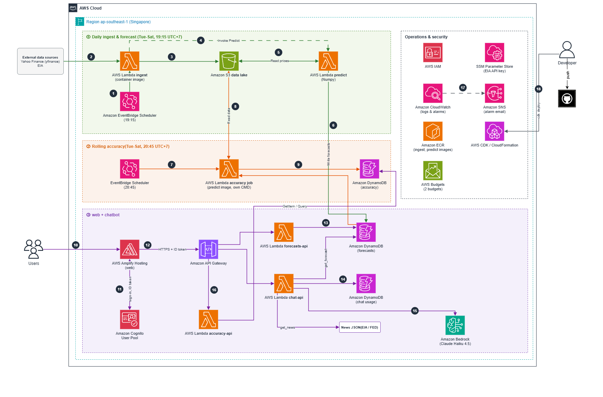

# CPAWS: dự báo giá hàng hóa trên AWS

CPAWS là ứng dụng web dự báo **khoảng giá** vàng, bạc, dầu Brent và dầu WTI cho 1–7 phiên giao dịch tới. Kết quả hiển thị theo USD và VND, kèm một chatbot tiếng Việt trên Amazon Bedrock để giải thích dự báo. Hệ thống chạy serverless trên AWS (`ap-southeast-1`) và tự cập nhật mỗi ngày giao dịch.

Đây là dự án nhóm 5 người của chương trình thực tập FCAJ (First Cloud AI Journey), thực hiện từ 12/10 đến 29/11/2026.

> *English summary: CPAWS forecasts 1–7 session return quantiles for gold, silver, Brent and WTI, shows price ranges in USD/VND, and explains them through a Vietnamese chatbot on Amazon Bedrock. It runs serverless on AWS (Lambda, EventBridge Scheduler, DynamoDB, API Gateway, Cognito, Amplify) and is deployed with AWS CDK.*

**Không phải lời khuyên đầu tư.** Mọi con số chỉ là ước tính và có thể sai. Chatbot được thiết kế để từ chối tư vấn mua, bán.

## Sản phẩm làm gì

- **Dự báo phân phối, không dự báo một con số.** Với mỗi tài sản và mỗi kỳ hạn h = 1–7 phiên, hệ thống dự báo 7 phân vị của log return. Web hiển thị khoảng 80% (q10–q90), trung vị và xác suất tăng, quy đổi ra khoảng giá theo USD và VND.
- **Đo độ tin cậy trên dữ liệu chạy thật.** Job `rolling_8w` so các dự báo đã phát hành với giá thật trong 8 tuần gần nhất, tính độ bao phủ và độ rộng của khoảng 80%.
- **Chatbot có trích nguồn.** Con số chỉ lấy từ tool `get_forecast` (đọc DynamoDB). Tin trích dẫn lấy từ thông cáo Fed/EIA gắn nhãn tay, có link nguồn; server chỉ giữ link của tin do tool `get_news` trả về trong lượt hỏi. Giới hạn 20 lượt/người/ngày và 100 lượt/ngày cho cả hệ thống.
  - `/chat` dùng prompt `chatbot-haiku-v2`. Benchmark chưa đạt ngưỡng (v2: 14/30; v4: bộ B 17/30, bộ A 5/8), 0 vi phạm chính sách; chi tiết ở [Chương 3](docs/defense/chatbot.md).
- **Mô hình đang phát hành là `baseline-q252`**: phân vị thực nghiệm của return trong 252 phiên gần nhất, chỉ dùng dữ liệu đã có tại thời điểm dự báo.
  - Nhóm đã thử DLinear, CEEMDAN và các mô hình theo biến động. Trong validation 2019, chưa challenger nào đáp ứng đủ tiêu chí thay champion ([ADR-0008](docs/adr/0008-target-quantiles-evaluation.md)): cận dưới CI 95% của `pinball_skill` phải lớn hơn 0. Vì vậy nhóm giữ `baseline-q252`.
  - Ứng viên S1a (co giãn khoảng theo biến động) chạy song song (shadow) từ 04/11/2026, không hiển thị cho người dùng.
  - Tập test 2020 → nay chạy đúng một lần ngày 16/11/2026: S1a cải thiện `pinball_skill` có ý nghĩa thống kê (sau hiệu chỉnh Holm) trên bạc (+2,12%), WTI (+4,49%) và Brent (+4,21%); vàng chưa đủ bằng chứng. Kết quả chỉ dùng cho báo cáo, không tự động thay champion; chi tiết ở [Chương 2](docs/defense/phuong-phap-danh-gia.md).

## Kiến trúc



*Sơ đồ hiện trạng do nhóm vẽ bằng draw.io ([file nguồn](docs/architecture/CPAWS-architecture-current.drawio)).*

- **Luồng hằng ngày** (19:15 giờ Việt Nam, thứ Ba–thứ Bảy): EventBridge Scheduler gọi Lambda `ingest` (container image), Lambda này ghi snapshot giá lên S3. Ingest chạy xong (kể cả khi một nguồn lỗi), Lambda Destinations (OnSuccess và OnFailure) gọi Lambda `predict` (container image, NumPy); predict bỏ qua tài sản thiếu phiên mới nhất và báo alarm. Predict ghi dự báo vào DynamoDB đúng một lần, không ghi đè.
- **Đo độ tin cậy** (20:45): Lambda `accuracy-job` ghi kết quả vào DynamoDB `cpaws-dev-accuracy`.
- **Phục vụ người dùng:** web React trên Amplify Hosting đăng nhập bằng Cognito, rồi gọi REST API Gateway (Cognito authorizer). API gồm các Lambda `forecasts-api`, `accuracy-api` và `chat-api`; `chat-api` gọi Claude Haiku 4.5 qua Bedrock Converse.
- **Vận hành:**
  - Hạ tầng viết bằng AWS CDK (Python), chia thành 5 stack: `CpawsData`, `CpawsServing`, `CpawsAuth`, `CpawsApi`, `CpawsOps`.
  - 6 CloudWatch alarm gửi email qua SNS.
  - API key EIA lưu trong SSM Parameter Store.
  - AWS Budgets theo dõi chi phí.
  - Không có endpoint, NAT Gateway hay máy chủ chạy 24/7.

Chi tiết và đối chiếu với bản đề xuất: [Chương 4](docs/defense/kien-truc-trien-khai.md).

## Cấu trúc repo

| Thư mục | Nội dung |
|---|---|
| `src/data/` | Thu thập, làm sạch giá theo lịch giao dịch (`python -m src.data.ingest_prices`) |
| `src/features/`, `src/forecast/` | Đặc trưng dùng chung cho train và predict, mốc 252 phiên, S1a, Lambda predict |
| `src/eval/` | Pinball loss, kiểm định thống kê, walk-forward, job `rolling_8w`, runner test2020 |
| `src/chatbot/` | Luồng chat, tool `get_forecast` và `get_news`, kiểm trích nguồn, giới hạn lượt hỏi |
| `infra/` | AWS CDK: `app.py` (tham số, tag image), `stacks/` (5 stack), `lambda/` (handler của API) |
| `docker/` | Dockerfile của image Lambda ingest và predict (base image ghim theo digest) |
| `web/` | React + TypeScript + Vite, đăng nhập Cognito |
| `tests/` | Test Python, gồm test chống rò rỉ dữ liệu tương lai và test synth CDK |
| `docs/` | ADR, hợp đồng API, báo cáo (`docs/defense/`), thí nghiệm, sơ đồ kiến trúc |

## Chạy trên máy

Cần Python 3.11+ và Node.js 22.12+.

```bash
git clone https://github.com/CPAWS-AWS-FCAJ/CPAWS-commodity-forecasting.git
cd CPAWS-commodity-forecasting

python -m venv .venv
source .venv/bin/activate          # Windows: .venv\Scripts\activate
pip install -r requirements-dev.txt
python -m ruff check .
python -m pytest -q

cd web
npm ci
npm run dev                        # http://localhost:5173; không đặt VITE_API_URL thì web chạy bằng dữ liệu mẫu
```

CI (GitHub Actions) chạy ở mọi push và pull request: `ruff`, `pytest`, cùng `typecheck`, `test`, `build` của web. CI không deploy.

## Triển khai

- **Hạ tầng:** deploy bằng `cdk deploy` theo từng stack, chạy tay từ máy người phụ trách hạ tầng.
- **Web:** build bằng `npm run build` rồi upload lên Amplify Hosting.
- Thứ tự deploy, các tham số `-c` bắt buộc, cách rollback và lịch sử các lần deploy: xem [tài liệu triển khai và vận hành](docs/defense/trien-khai-van-hanh.md).
- **Nhánh:** `developer` là nhánh phát triển (mọi thay đổi qua PR, cần 1 approve và CI xanh); `production` là nhánh phát hành bản nộp cuối kỳ.
- **Bí mật:** repo không chứa bí mật. `.env` nằm trong `.gitignore`; trên AWS, key lưu trong SSM Parameter Store.

## Tài liệu

| Tài liệu | Nội dung |
|---|---|
| [Mở đầu](docs/defense/mo-dau.md) | Bài toán, phạm vi, mục tiêu và mức độ đạt |
| [Chương 1. Mô hình và dữ liệu](docs/defense/mo-hinh-va-du-lieu.md) | Target, nguồn dữ liệu, mốc 252 phiên, các mô hình đã thử |
| [Chương 2. Phương pháp và kết quả đánh giá](docs/defense/phuong-phap-danh-gia.md) | Pinball skill, hiệu chỉnh, rolling accuracy, kết quả test2020 |
| [Chương 3. Chatbot](docs/defense/chatbot.md) | `POST /chat`, Bedrock, tool, benchmark |
| [Chương 4. Kiến trúc, triển khai và vận hành](docs/defense/kien-truc-trien-khai.md) | Kiến trúc hiện trạng, CDK, luồng chạy, giám sát |
| [Chương 5. Bảo mật và chi phí](docs/defense/security-and-cost.md) | IAM, Cognito, bảo vệ dữ liệu, chi phí thực tế |
| [ADR](docs/adr/) | Các quyết định kiến trúc, dữ liệu và đánh giá (0001–0014) |
| [Hợp đồng API](docs/api/contract.md) | Bảng `Forecasts`, các endpoint |

## Nguồn dữ liệu và giới hạn

- **Giá:** lấy qua thư viện `yfinance` (GLD, SLV, BZ=F, CL=F, VND=X).
  - Vàng và bạc dùng quỹ GLD, SLV làm chuỗi đại diện, không phải giá giao ngay.
  - README của yfinance ghi API Yahoo Finance chỉ dành cho mục đích cá nhân, và nhóm không có giấy phép của Yahoo. Nhóm coi đây là rủi ro đã biết; đánh giá ở [ADR-0005](docs/adr/0005-price-data-sources.md).
  - Repo không chứa dữ liệu giá. Web chỉ mở sau khi đăng nhập và không có tính năng tải dữ liệu.
- **Tin tức:** chỉ gồm thông cáo chính thức của Fed và EIA, gắn nhãn tay ([ADR-0013](docs/adr/0013-manual-news-labels-until-defense.md)).
- **Guardrails:** Bedrock Guardrails không bật trong phạm vi dự án. Các lớp kiểm soát của chatbot được mô tả ở [Chương 3](docs/defense/chatbot.md).

## Nhóm

| Thành viên | Vai trò |
|---|---|
| Khải | Research Lead: mô hình, đặc trưng, Lambda predict |
| Long | Modeling & Evaluation: baseline, đánh giá, champion/challenger |
| Phước | News & Chatbot: gắn nhãn tin, chatbot |
| Tiến | Platform: CDK, Lambda, web, deploy |
| Tuấn | Data & Security: IAM, Cognito, API, chi phí |

## Giấy phép

[MIT](LICENSE).
