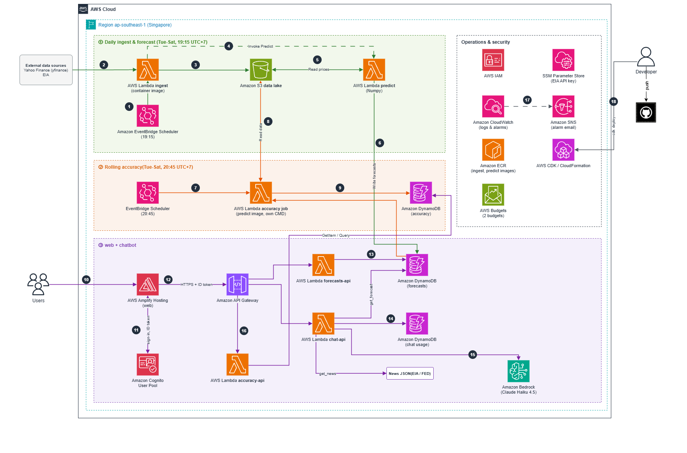

<!--
Slide phần Kiến trúc (slide #5 trong docs/defense/khung-slide.md) cho buổi trình bày cuối kỳ (hội đồng thực tập FCAJ-AWS).
Nội dung lấy từ docs/defense/kien-truc-trien-khai.md (Chương 4) và trien-khai-van-hanh.md trên developer. Mỗi slide ghi nguồn ở dòng cuối.
Không đưa Account ID, ARN, ID token, domain hay email vào slide.
Xuất PDF: npx @marp-team/marp-cli docs/defense/slides-kien-truc.md --pdf --allow-local-files
-->

<!-- _class: arch -->

# Kiến trúc tổng thể

- **19:15** (T3–T7): ingest → S3 → predict → DynamoDB; S1a shadow
- **20:45**: chấm điểm `rolling_8w`
- **Web, API, chatbot** sau Cognito
- **5 stack CDK**, serverless: không VPC, không NAT, không máy chạy 24/7

<!--
Ghi chú người nói: Hệ thống có ba luồng. Luồng 1 chạy mỗi tối sau phiên Mỹ: lấy giá, ghi S3, rồi Lambda predict ghi dự báo vào DynamoDB; bản ghi đã phát hành không bị ghi đè nên chạy lại an toàn. Luồng 2 chạy 90 phút sau để chấm điểm các dự báo đã lưu khi biết giá thật. Luồng 3 là phần người dùng thấy: web chỉ đọc kết quả tính sẵn, chatbot lấy số qua tool đọc cùng bảng nên không lệch với trang dự báo. Toàn bộ hạ tầng viết bằng CDK, 5 stack.
Nếu hỏi "sao không có SageMaker": chuyển sang slide dự phòng tiếp theo.
-->

Nguồn: sơ đồ hiện trạng 13/11 (#125); Chương 4 §4.1–4.2

---

# Dự phòng: khác gì so với proposal

| Proposal | Đang chạy | Vì sao |
|---|---|---|
| Step Functions → SageMaker → Model Registry, retrain hằng tuần | Lambda nối Lambda; champion `baseline-q252`, S1a shadow | Mô hình học sâu không vượt mốc trên validation 2019 (ADR-0011, 0012) |
| Bedrock gắn nhãn tin + Knowledge Bases | Tin demo gắn nhãn tay, đóng gói trong Lambda chat | Gắn nhãn tự động chưa đạt ngưỡng (ADR-0013) |
| Guardrails | Không bật | Chốt 11/11: bật sau benchmark sẽ đổi hành vi bản đã đánh giá |
| GitHub Actions CI/CD, Amplify nối Git | Chỉ CI; deploy từ máy; Amplify upload zip | Repo public, GitHub không giữ quyền AWS; giữ domain cho người chấm |
| — | Job `rolling_8w`, `/accuracy`, shadow S1a, 6 alarm, giới hạn lượt chat | Thêm để đo dự báo chạy thật và kiểm soát chi phí |

<!--
Ghi chú người nói: Khung của proposal vẫn giữ: Scheduler, Lambda, S3, DynamoDB, API Gateway, Cognito, Amplify, Bedrock. Những khối bỏ đi đều có ADR. Lý do chính là kết quả mô hình: khi mô hình phức tạp không thắng mốc thống kê, dựng pipeline retrain trên SageMaker chỉ thêm chi phí và rủi ro.
Chỉ chiếu slide này khi hội đồng hỏi.
-->

Nguồn: Chương 4 §4.1; ADR-0011, ADR-0012, ADR-0013

